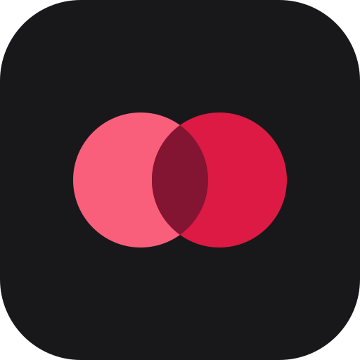
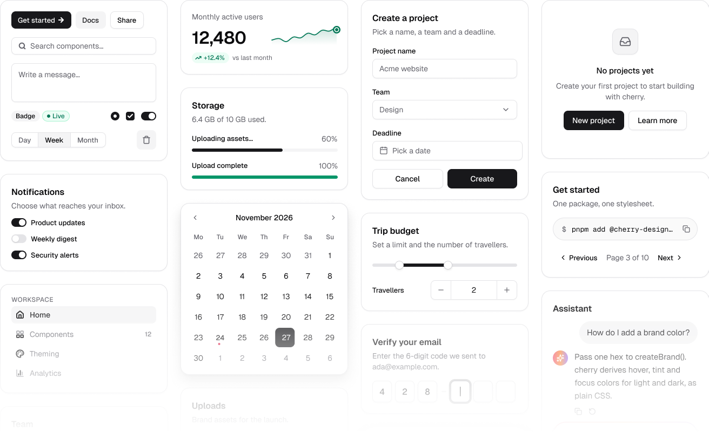

<div align="center">
  <a href="https://cherry.al/">
    <picture>
      <source media="(prefers-color-scheme: dark)" srcset=".github/assets/cherry-mark-dark.svg" />
      
    </picture>
  </a>

  <h1>cherry 2.0</h1>

  <p><strong>One color in. A design system out.</strong></p>

  <p>
    A themeable React design system in plain CSS.<br />
    Accessible by default (WCAG 2.2 AA), zero styling runtime, Server Components ready.
  </p>

  <p>
    <a href="https://www.npmjs.com/package/@cherry-design-system/react"></a>
    <a href="https://github.com/cherry-design-system/react/blob/main/LICENSE"></a>
  </p>

  <p>
    <code>pnpm add @cherry-design-system/react lucide-react</code>
  </p>

  <p>
    <a href="https://cherry.al/">Docs</a> ·
    <a href="#use">Use</a> ·
    <a href="#how-it-works">How it works</a> ·
    <a href="#develop">Develop</a> ·
    <a href="./CHANGELOG.md">Changelog</a>
  </p>
</div>

<p align="center">
  <picture>
    <source media="(prefers-color-scheme: dark)" srcset=".github/assets/showcase-dark.png" />
    
  </picture>
</p>

## Install

```bash
pnpm add @cherry-design-system/react lucide-react
```

## Use

```tsx
// app/layout.tsx
import "@cherry-design-system/react/styles.css";
import { themeInitScript } from "@cherry-design-system/react/theme-init";

export default function RootLayout({
  children,
}: {
  children: React.ReactNode;
}) {
  return (
    <html lang="en" suppressHydrationWarning>
      <head>
        <script dangerouslySetInnerHTML={{ __html: themeInitScript }} />
      </head>
      <body className="cherry-root">{children}</body>
    </html>
  );
}
```

```tsx
import { Button, ThemeToggle } from "@cherry-design-system/react";

<Button variant="outline">Learn more</Button>
<ThemeToggle />
```

## How it works

- **Static CSS.** Every rule lives in `@layer cherry`, so any unlayered rule of yours wins without `!important`. Import `styles.css` once, or only the files you use from `css/*`.
- **Stable hooks.** Classes are `cherry-<name>`, variants are `data-*` attributes, tokens are `--cherry-*` custom properties. `style-api.json` lists them all.
- **Modes.** The `dark` class on `<html>` switches every token (no re-render). Scope a section with `data-cherry-mode="dark"` or `"light"`. `useColorMode()` reads and sets the preference (system, light or dark).
- **Brands.** `createBrand("acme", { accent: "#5b5bd6" })` returns validated CSS for a `[data-cherry-brand="acme"]` scope.
- **Motion.** Durations and easings are tokens (`--cherry-duration-*`, `--cherry-easing-*`), and every animation honours `prefers-reduced-motion`.

## AI agent skill

`skills/cherry-react` teaches Claude and other coding agents to build with cherry correctly: which component to use, exact props and values, tokens instead of hardcoded styles, and what accessibility needs from the app. Its component and token references are generated from the source, so they match each release.

```bash
npx -y skills add cherry-design-system/react
```

See [`skills/cherry-react/README.md`](./skills/cherry-react/README.md) for manual installs and other agents.

## Develop

```bash
pnpm install
pnpm dev        # playground
pnpm check      # generate, typecheck, test, contract
pnpm build
pnpm test:a11y  # accessibility checks in Chromium (first run: pnpm exec playwright install chromium)
```

Tokens are DTCG JSON in `tokens/`; `pnpm generate` writes `src/styles/tokens.css` and the TypeScript types. Each component has a `manifest.json` (its classes and data attributes); the contract check fails CI when the CSS and the manifest disagree.

`pnpm test:a11y` runs the playground through axe (WCAG 2.2 AA, light and dark, desktop and 320px, every popup open) and checks what axe cannot: visible focus on every kind of tab stop, focus traps and focus return, outlines in forced colors (Windows High Contrast), placeholder contrast and reflow. It runs in CI after the build.

See [`CONTRIBUTING.md`](./CONTRIBUTING.md) before opening a pull request.

## Release

Releases publish from CI. In one change, bump `version` in `package.json` and add its `## [x.y.z] - YYYY-MM-DD` section to [`CHANGELOG.md`](./CHANGELOG.md) (CI fails a version bump without one). Once it lands on `main`, the Release workflow runs the checks, waits for approval on the `npm` environment, publishes to npm through trusted publishing with provenance (no token), and creates the `vX.Y.Z` tag and GitHub release with that changelog section as the notes.

## Security

Report vulnerabilities privately through the [Security tab](https://github.com/cherry-design-system/react/security); see [`SECURITY.md`](./SECURITY.md).
